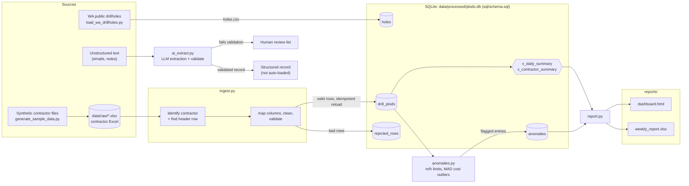
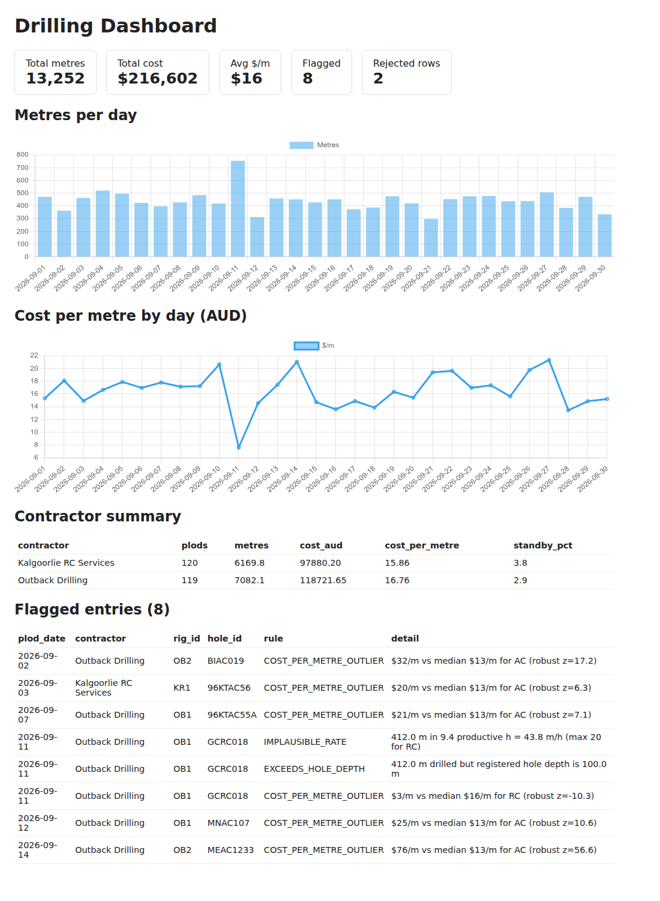
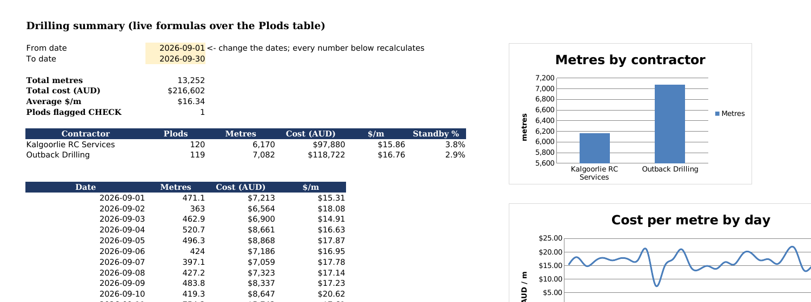
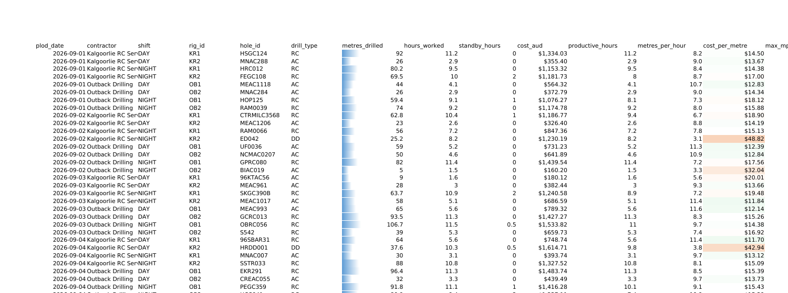

# PlodTrack — drilling data pipeline & dashboard

A small project for tracking exploration drilling and costs: ingest messy contractor Excel files,
store them in a SQL database, flag unusual entries, and produce dashboards and reports.
The bundled sample data is **synthetic**.

| Capability | Where it lives |
|---|---|
| Ingest contractor Excel files with less manual entry | `src/plodtrack/ingest.py` – per-contractor column mapping, title-row detection, cleaning, validation, idempotent reload |
| SQL storage | `sql/schema.sql` – constraints, unique key, summary views |
| Track drill plods & costs | `drill_plods` table, `v_daily_summary`, `v_contractor_summary` |
| Dashboards & reports | `report.py` → `reports/dashboard.html` + `reports/weekly_report.xlsx` |
| Flag unusual entries | `anomalies.py` – explainable rules (physical m/h limits, robust MAD cost outliers) |
| Interactive Excel workbook | `excel_workbook.py` → `reports/plod_workbook.xlsx` – Excel Table, structured refs, SUMIFS/COUNTIFS/INDEX-MATCH, named ranges, data validation, conditional formatting, native charts |
| AI-assisted extraction | `ai_extract.py` – LLM extraction whose output is validated and routed to human review |

## The data

| Dataset | Real or synthetic | What it is | Where |
|---|---|---|---|
| **Drillhole collars** | **Real** – WA public drillhole data (Kalgoorlie area, gold targets), CC BY 4.0 | ~5,800 holes: hole ID, type (RC/DD/AC), max depth, operator, project, latitude/longitude | `data/external/wa_drillholes/holes.csv` (fetched by `load_wa_drillholes.py`) |
| **Contractor plods** | **Synthetic** | Daily drilling records from 2 invented contractors for Sep 2026 (239 plods): date, shift, rig, hole, drill type, metres, hours, standby hours, cost (AUD) | `data/raw/*.xlsx` (made by `generate_sample_data.py`) |

The two contractors deliberately use **different layouts**, like real life. One has a plain header row (`Date`, `Metres`, `Cost ($)`), the other has title rows above the header and different names (`Plod Date`, `Total Metres`, `Invoice AUD`, `01/09/2026` dates). A few bad rows are planted so the pipeline has something to catch. Synthetic plods are attached to real hole IDs, so costs, dates and productivity are **not real operational figures**.

After the pipeline runs, `data/processed/plods.db` holds 239 clean plods, 5,824 holes, 8 flagged anomalies and 2 rejected rows.

## Architecture



## Snapshots

**HTML dashboard** (`reports/dashboard.html`): KPIs, metres and $/m by day, contractor summary and the flagged entries with the reason for each.



**Excel workbook, Summary sheet** (`reports/plod_workbook.xlsx`): formula-driven KPIs and tables, with date inputs in yellow and native charts.



**Excel workbook, Plods sheet**: Excel Table with calculated columns, data bars on metres and a colour scale on $/m (outliers shaded).



*Screenshots are regenerated from the synthetic data; see "Run it" to reproduce them.*

## Run it
```bash
python3 -m venv .venv && source .venv/bin/activate
pip install -r requirements.txt
export PYTHONPATH=src
python -m plodtrack.generate_sample_data
python -m plodtrack.ingest
python -m plodtrack.anomalies
python -m plodtrack.report        # open reports/dashboard.html
python -m plodtrack.excel_workbook  # open reports/plod_workbook.xlsx
pytest
```

## The Excel workbook (`reports/plod_workbook.xlsx`)
Unlike `weekly_report.xlsx` (a static data dump), this one is built to be used and edited in Excel:

| Sheet | What it demonstrates |
|---|---|
| **Plods** | An Excel **Table** with calculated columns written as structured references (`productive_hours`, `metres_per_hour`, `cost_per_metre`), an `INDEX/MATCH` lookup of the per-rig limit, and a `rate_check` flag that mirrors the Python `IMPLAUSIBLE_RATE` rule. **Data validation** drop-downs (shift, drill type) and non-negative number checks block bad manual entry. **Conditional formatting**: flagged rows turn red, data bars on metres, colour scale on $/m. |
| **Summary** | KPIs, contractor and daily tables built only from `SUMIFS` / `COUNTIFS` / `IFERROR` over the table, filtered by the **From/To date** input cells (named ranges `FromDate`, `ToDate`). Two native charts. |
| **Limits** | Yellow assumption cells (`MaxMph`, `DrillTypes` named ranges). Change a limit and the flags, counts and charts recalculate. |

Sample values were cross-checked: recalculating the workbook in LibreOffice gives the same total metres and cost as the SQL database.

## Ideas to extend
- Add a costs/budget table and variance-to-budget view
- Mining inventory (stockpile tonnes & grade) tables
- Safety metrics (LTIFR, near-miss counts)
- Swap SQLite for Postgres; schedule ingest on a folder watcher
- Streamlit front end for reviewing flagged rows
