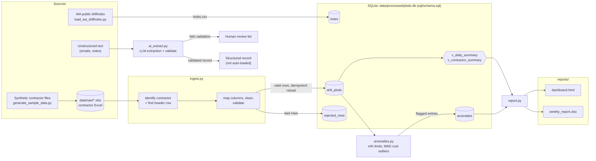
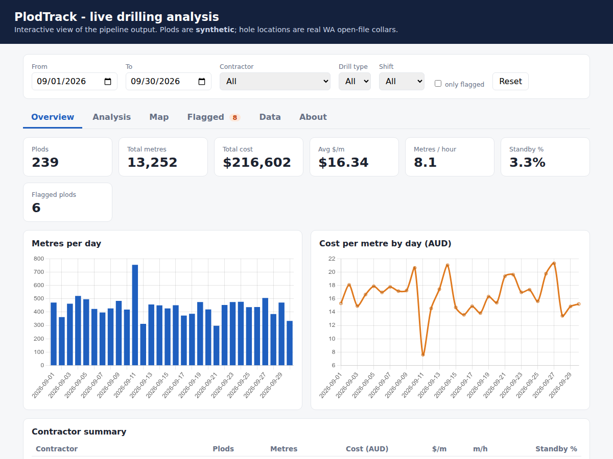

# PlodTrack — drilling data pipeline & dashboard

A small project for tracking exploration drilling and costs: ingest messy contractor Excel files,
store them in a SQL database, flag unusual entries, and produce dashboards and reports.
The bundled sample data is **synthetic**.

**Live demo:** https://husthunterpy01.github.io/PlodTrack/ (interactive filters, charts and a map of the real WA holes; built by `python -m plodtrack.build_site` into `docs/index.html`).

| Capability | Where it lives |
|---|---|
| Ingest contractor Excel files with less manual entry | `src/plodtrack/ingest.py` – per-contractor column mapping, title-row detection, cleaning, validation, idempotent reload |
| SQL storage | `sql/schema.sql` – constraints, unique key, summary views |
| Track drill plods & costs | `drill_plods` table, `v_daily_summary`, `v_contractor_summary` |
| Dashboards & reports | `report.py` → `reports/dashboard.html` + `reports/weekly_report.xlsx` |
| Flag unusual entries | `anomalies.py` – explainable rules (physical m/h limits, robust MAD cost outliers) |
| Interactive Excel workbook | `excel_workbook.py` → `reports/plod_workbook.xlsx` – Excel Table, structured refs, SUMIFS/COUNTIFS/INDEX-MATCH, named ranges, data validation, conditional formatting, native charts |
| AI-assisted extraction | `ai_extract.py` – LLM extraction (Claude or Groq) whose output is parsed defensively, validated with the ingest rules, checked that every value actually appears in the source text, and routed to human review when it fails |

## The data

| Dataset | Real or synthetic | What it is | Where |
|---|---|---|---|
| **Drillhole collars** | **Real** – WA public drillhole data (Kalgoorlie area, gold targets), CC BY 4.0 | ~5,800 holes: hole ID, type (RC/DD/AC), max depth, operator, project, latitude/longitude | `data/external/wa_drillholes/holes.csv` (fetched by `load_wa_drillholes.py`) |
| **Contractor plods** | **Synthetic** | Daily drilling records from 2 invented contractors for Sep 2026 (239 plods): date, shift, rig, hole, drill type, metres, hours, standby hours, cost (AUD) | `data/raw/*.xlsx` (made by `generate_sample_data.py`) |

The two contractors deliberately use **different layouts**, like real life. One has a plain header row (`Date`, `Metres`, `Cost ($)`), the other has title rows above the header and different names (`Plod Date`, `Total Metres`, `Invoice AUD`, `01/09/2026` dates). A few bad rows are planted so the pipeline has something to catch. Synthetic plods are attached to real hole IDs, so costs, dates and productivity are **not real operational figures**.

After the pipeline runs, `data/processed/plods.db` holds 239 clean plods, 5,824 holes, 8 flagged anomalies and 2 rejected rows.

## Data preprocessing

Each step below was chosen after inspecting the raw files, not assumed. All of it runs inside `ingest.py` unless noted.

**What inspection of the real WA collars (6,000 rows) showed, and what the pipeline does about it**

| Finding | Handling |
|---|---|
| 88 hole IDs appear more than once (176 rows). The same ID can point to different collars, so joining plods to them would be ambiguous. | Drop all rows of ambiguous IDs (`load_holes`), leaving 5,824 holes with a unique key. They are excluded rather than picking one at random. |
| Hole types include `RAB` (3,256 rows) and `UNKN` (113), but plods only record `RC`, `DD` and `AC`. | The sample-data generator keeps only RC/DD/AC holes. The schema has a `CHECK` on `drill_type`, so unknown types can't get in later. |
| `maxdepth` ranges from 1 m to 2,217 m (median 45 m). 96 holes are under 5 m or over 400 m. | Restrict to 5-400 m for realistic plods. Keep `max_depth_m` so the `EXCEEDS_HOLE_DEPTH` rule can compare metres drilled against it. |
| Dates are stored as Unix epoch milliseconds (e.g. `637804800000`). | Convert to ISO `YYYY-MM-DD` dates on load. |
| No nulls, no stray whitespace in IDs. | No imputation needed, and none is done. |

**What inspection of the contractor Excel files showed**

| Finding | Handling |
|---|---|
| Same data, different column names per contractor (`Metres` vs `Total Metres`, `Cost ($)` vs `Invoice AUD`). | Declarative per-contractor mapping (`CONTRACTORS`) to one canonical schema. Missing required columns fail loudly. |
| One file has title rows above the table, so a plain `read_excel` gives wrong headers. | `find_header_row` scans for the first known header instead of hard-coding the row. |
| Dates are real dates in one file and `dd/mm/yyyy` text in the other. | `to_datetime(..., dayfirst=True, errors="coerce")`: Australian format, and unparseable values become a rejection and not a crash. |
| Stray whitespace and casing (`"rc "`). | `strip()` + `upper()` on shift, drill type, rig and hole IDs. |
| Standby hours can be missing or blank. | Filled with 0 (no standby recorded). This is the only imputation; the required fields are never guessed. |
| Hours of 0, duplicated rows. | Rejected with a reason and row number into `rejected_rows` rather than silently dropped. |
| Implausible but valid-looking values (412 m in 9 h, a 6x cost spike). | **Not** removed. They pass validation and are flagged by `anomalies.py`, because a human should decide whether they're errors. |

**Design principles**
- **Reject, flag, or keep:** impossible values are rejected, suspicious values are flagged, and the rest is kept as-is.
- **Nothing disappears silently:** every dropped row has a reason in `rejected_rows`.
- **Idempotent:** re-running replaces each file's rows (`DELETE` by `source_file`), so no duplicates build up.
- **Rules enforced twice:** in Python (`clean`) and in SQL (`CHECK`, `UNIQUE`), so a bypass of one still hits the other.

## Architecture



## Snapshots

**HTML dashboard** (`reports/dashboard.html`): KPIs, metres and $/m by day, contractor summary and the flagged entries with the reason for each.


**Live interactive page** (GitHub Pages, `docs/index.html`): filter by date, contractor, drill type and shift; every KPI, chart, table and the map recompute in the browser.



**Excel workbook, Summary sheet** (`reports/plod_workbook.xlsx`): formula-driven KPIs and tables, with date inputs in yellow and native charts.


**Excel workbook, Plods sheet**: Excel Table with calculated columns, data bars on metres and a colour scale on $/m (outliers shaded).


*Screenshots are regenerated from the synthetic data; see "Run it" to reproduce them.*

## Run it
```bash
python3 -m venv .venv && source .venv/bin/activate
pip install -r requirements.txt
export PYTHONPATH=src
python -m plodtrack.generate_sample_data
python -m plodtrack.ingest
python -m plodtrack.anomalies
python -m plodtrack.report        # open reports/dashboard.html
python -m plodtrack.excel_workbook  # open reports/plod_workbook.xlsx
python -m plodtrack.build_site      # open docs/index.html (the live page)
pytest
```

## The Excel workbook (`reports/plod_workbook.xlsx`)
Unlike `weekly_report.xlsx` (a static data dump), this one is built to be used and edited in Excel:

| Sheet | What it demonstrates |
|---|---|
| **Plods** | An Excel **Table** with calculated columns written as structured references (`productive_hours`, `metres_per_hour`, `cost_per_metre`), an `INDEX/MATCH` lookup of the per-rig limit, and a `rate_check` flag that mirrors the Python `IMPLAUSIBLE_RATE` rule. **Data validation** drop-downs (shift, drill type) and non-negative number checks block bad manual entry. **Conditional formatting**: flagged rows turn red, data bars on metres, colour scale on $/m. |
| **Summary** | KPIs, contractor and daily tables built only from `SUMIFS` / `COUNTIFS` / `IFERROR` over the table, filtered by the **From/To date** input cells (named ranges `FromDate`, `ToDate`). Two native charts. |
| **Limits** | Yellow assumption cells (`MaxMph`, `DrillTypes` named ranges). Change a limit and the flags, counts and charts recalculate. |

Sample values were cross-checked: recalculating the workbook in LibreOffice gives the same total metres and cost as the SQL database.

## AI extraction: how it was tested
`ai_extract.py` turns a free-text shift report into a plod record. The model is never trusted: output is parsed tolerantly (code fences, surrounding prose), validated with the same rules as the Excel ingest, then **grounded** (each value must appear in the source text). Anything failing goes to `needs_review` with the reasons.

Tested live against Groq (`openai/gpt-oss-120b`, set `GROQ_API_KEY`) with 5 reports; results were identical across 2 runs:

| Report | Outcome |
|---|---|
| Complete, clean report | Extracted, no review needed |
| Cost not yet invoiced | Extracted, `cost_aud` left null (allowed) |
| Zero hours worked | Flagged `hours_worked` |
| "Evening shift" (not DAY/NIGHT) | Flagged `shift`. An earlier version silently mapped it to NIGHT; the prompt and grounding check fixed that |
| Toolbox talk, no plod at all | Every required field flagged |

Limits: 5 hand-written reports is a smoke test, not an accuracy benchmark. Results can vary between models and runs. Records that pass are returned but not yet loaded into the database.

## Ideas to extend
- Add a costs/budget table and variance-to-budget view
- Mining inventory (stockpile tonnes & grade) tables
- Safety metrics (LTIFR, near-miss counts)
- Swap SQLite for Postgres; schedule ingest on a folder watcher
- Streamlit front end for reviewing flagged rows
